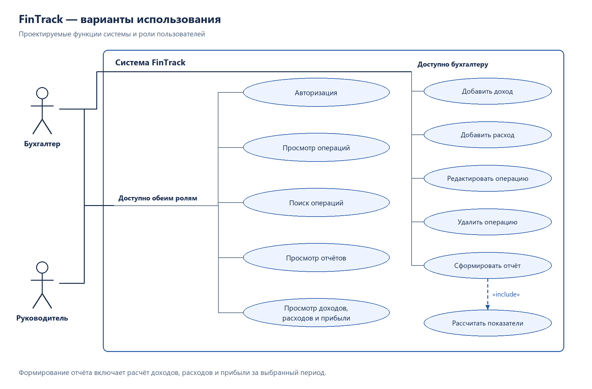
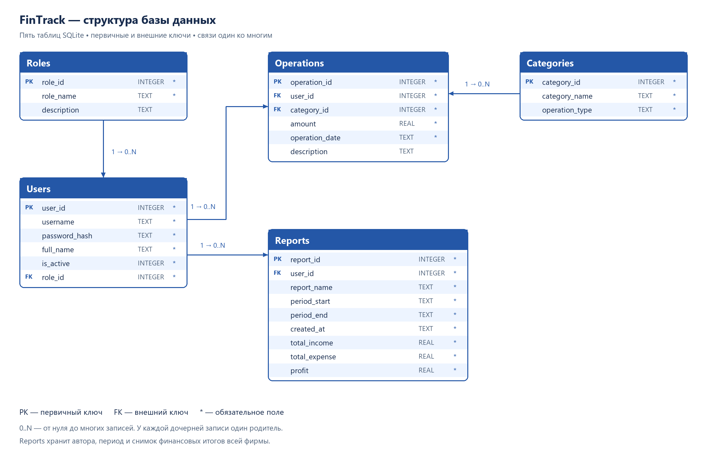

# Учет доходов/расходов небольшой фирмы
## Цель работы
Изучить основные этапы создания информационной системы. Научиться описывать её задачи, пользователей и основные функции. Получить навыки создания  Use Case диаграмм и блок-схем для наглядного представления работы системы.
## Практическая часть
## 1. Постановка задачи
### 1.1 Описание предметной области
Предметной областью проекта является финансовый учет небольшой фирмы. Для учёта доходов и расходов проектируется информационная система «FinTrack». В целевой системе бухгалтер ведёт операции и формирует отчёты, руководитель просматривает и ищет операции, контролирует финансовые показатели. Реализовано консольное приложение на Python с авторизацией, регистрацией, ролевыми меню, ведением операций, категорий, пользователей и отчётов. Данные сохраняются в SQLite. Модели, репозитории, сервисы и интерфейс разделены по модулям.
### 1.2	Цели и задачи системы
1.	**Регистрация доходов фирмы**  
2.	**Регистрация расходов фирмы**  
3.	**Хранение информации о финансовых операциях**  
4.	**Поиск и просмотр операций**  
5.	**Изменение и удаление операций**  
6.	**Расчёт общей суммы доходов**  
7.	**Расчёт общей суммы расходов**  
8.	**Расчёт прибыли фирмы**  
9.	**Формирование финансовых отчётов**  

### 1.3 Пользователи системы (актеры) и их роли

- **Руководитель:** обычный пользователь. Просматривает и ищет финансовые операции, а также финансовые отчеты.
- **Бухгалтер:** главный пользователь. Добавляет, удаляет, изменяет информацию о финансовых операциях, формирует финансовую отчетность.

### 1.4 Основной функционал

-	**Добавление дохода** (ввод полученной суммы, даты и категории поступления)
-	**Добавление расхода** (ввод затраченной суммы, даты, а также категории расхода)
-	**Редактирование доходов/расходов** (изменение данных сохраненной финансовой операции)
-	**Удаление доходов/расходов** (удаление данных об операциях)
-	**Просмотр финансовых операций/отчетов**
-	**Расчет финансовых показателей**
-	**Формирование отчетов**

### 1.5 Архитектура проекта
Для проекта используется трехуровневая архитектура. Система состоит из трех основных уровней:
1.	**Слой интерфейса:** предназначен для взаимодействия пользователя с системой. С помощью него пользователь может просматривать и добавлять операции, просматривать финансовую отчетность и показатели.  
2.	**Слой бизнес-логики:** отвечает за обработку данных и правила работы системы.  
3.	**Слой данных:** отвечает за хранение информации. Хранит информацию о пользователях, финансовых операциях и т.д.  

Используются Python 3.10 или новее, стандартная библиотека и SQLite. Слой `ui` получает ввод и вызывает сервисы. Сервисы проверяют права и данные и координируют репозитории. SQL-запросы находятся в `repositories`, подключение и транзакции — в `database`. Модели `dataclass` передают данные между слоями.

| Роль | Доступные действия |
|---|---|
| Бухгалтер | Добавление, редактирование, удаление, поиск и просмотр операций, формирование и просмотр отчётов и показателей |
| Руководитель | Поиск и просмотр операций, просмотр отчётов и показателей |
## 2. Моделирование процессов и взаимодействий 
### 2.1 Use-case диаграмма:


### Er-диаграмма "Финансовый учет небольшой фирмы"


[Исходник Use Case](docs/diagrams/diagram.puml) и [исходник ER-диаграммы](docs/diagrams/er-diagram.puml) доступны для редактирования в PlantUML.

## 3. База данных и лабораторная работа 3

Готовая база находится в [src/fintrack.db](src/fintrack.db). [src/schema.sql](src/schema.sql) создаёт ту же структуру и заполняет все пять таблиц тестовыми данными. Скрипт выполняется в транзакции. Его повторный запуск удаляет прежние таблицы и заменяет данные учебным набором.

| Таблица | Назначение | Тестовых записей |
|---|---|---|
| Roles | Роли пользователей | 2 |
| Users | Пользователи, хеши паролей, активность и роль | 2 |
| Categories | Категории и тип операции `income` или `expense` | 6 |
| Operations | Финансовые операции, их суммы, даты и авторы | 12 |
| Reports | Автор, название, период, время формирования и снимок финансовых итогов | 3 |

Сохранены все 12 исходных операций, идентификаторы, пользователи и три отчёта. Для демонстрации ЛР4 хеши двух учебных аккаунтов заменены на хеши известных паролей, приведённых в разделе 4.1. Поле `login` приведено к имени `username`, даты отчётов — к `period_start` и `period_end`. Добавлены описание ролей, активность пользователей, названия и время создания отчётов. Время `created_at` исходных отчётов отражает пересоздание учебной базы, поскольку прежняя версия это поле не хранила.

### 3.1 Ключи и связи

`PK` на диаграмме обозначает первичный ключ, `FK` — внешний. Тип `INTEGER` используется для идентификаторов и активности, `TEXT` — для текста и дат, `REAL` — для сумм. Звёздочка обозначает обязательное поле.

| Родительская таблица | Дочерняя таблица и внешний ключ | Кратность |
|---|---|---|
| Roles.role_id | Users.role_id | 1 к 0..N |
| Users.user_id | Operations.user_id | 1 к 0..N |
| Categories.category_id | Operations.category_id | 1 к 0..N |
| Users.user_id | Reports.user_id | 1 к 0..N |

Каждая дочерняя запись ссылается на одного существующего родителя. `ON DELETE RESTRICT` защищает используемые роли, пользователей и категории от удаления, `ON UPDATE CASCADE` обновляет внешние ключи при изменении идентификатора родителя. При открытии соединения для записи требуется `PRAGMA foreign_keys = ON`.

Ограничения проверяют уникальность логинов и названий ролей, положительную сумму операции, допустимый тип категории и активность 0 или 1. Даты проверяются на формат `YYYY-MM-DD` и календарную корректность. Для отчёта проверяются порядок дат, неотрицательные доходы и расходы и равенство прибыли их разности с допуском менее половины копейки.

### 3.2 Расчёт отчётов

Доход или расход определяется через `Categories.operation_type`. Суммы операций всегда положительны. Отчёт охватывает операции всей фирмы за указанный период включительно. `Reports.user_id` обозначает автора отчёта.

Скрипт использует `JOIN` для получения типа категории, `SUM` и `CASE` для суммирования, `COALESCE` для нулевого результата при отсутствии операций. Прибыль равна доходам за вычетом расходов. В `Reports` сохраняется снимок итогов. После последующего изменения операций для актуальных итогов нужно сформировать новый отчёт.

| Период | Доходы | Расходы | Прибыль |
|---|---|---|---|
| Сентябрь 2026 | 137000 | 55500 | 81500 |
| Октябрь 2026 | 115000 | 63000 | 52000 |
| Сентябрь и октябрь 2026 | 252000 | 118500 | 133500 |

### 3.3 Запуск и проверка

Нужен Python 3.10 или новее. Дополнительные пакеты для работы программы не требуются. Из корня проекта запустите следующую команду.

```console
python src/main.py
```

Команда открывает интерактивное меню. Из папки `src` работает команда `python main.py`. Путь к базе определяется относительно расположения программы. Для диагностики используйте следующую команду.

```console
python src/main.py --check
```

Проверка открывает файл только для чтения, выводит количество записей, поля и типы, результаты `integrity_check` и `foreign_key_check`. Ожидаются количества 2, 2, 6, 12, 3, целостность `[('ok',)]` и ошибки связей `[]`.

Для создания отсутствующей базы из SQL запустите следующую команду из корня проекта.

```console
python src/main.py --init
```

Если база уже существует, программа сообщает об этом и завершает работу. Для учебного пересоздания сначала переместите существующий `src/fintrack.db` в резервную копию, затем повторите команду с `--init`. При ошибке создания незавершённый новый файл удаляется.

Для просмотра таблиц можно открыть `src/fintrack.db` в DB Browser for SQLite или SQLiteStudio. Например, этот запрос показывает операции вместе с автором и категорией.

```sql
SELECT o.operation_id, u.username, c.category_name,
       c.operation_type, o.amount, o.operation_date
FROM Operations AS o
JOIN Users AS u ON u.user_id = o.user_id
JOIN Categories AS c ON c.category_id = o.category_id
ORDER BY o.operation_date, o.operation_id;
```


## 4. Лабораторная работа 4

Реализация выполнена по методическим рекомендациям «Реализация слоя доступа к данным, бизнес-логики и пользовательского интерфейса» на основе репозитория FinTrack228, коммит `e17d760`.

### 4.1 Быстрый запуск и учебные пользователи

Распакуйте проект и откройте терминал в его корне. Установка дополнительных пакетов не требуется.

```console
python src/main.py
```

| Логин | Учебный пароль | Роль |
|---|---|---|
| accountant | Accountant2026! | Бухгалтер |
| manager | Manager2026! | Руководитель |

В интерактивном терминале пароль вводится без отображения символов. В базе хранится PBKDF2-HMAC-SHA256-хеш с индивидуальной случайной солью и 260000 итераций. Пользователь может сменить свой пароль после проверки текущего. Указанные пароли предназначены для демонстрационного набора.

При отсутствии базы выполните `python src/main.py --init`. Существующий файл эта команда сохраняет. Чтобы экспериментировать с отдельной базой, используйте следующие команды.

```console
python src/main.py --database demo.db --init
python src/main.py --database demo.db
python src/main.py --database demo.db --check
```

### 4.2 Структура и взаимодействие слоёв

```text
src/
  main.py                     запуск меню, параметры --init и --check
  database/__init__.py        путь к БД, соединение, транзакция, инициализация
  models/__init__.py          Role, User, Category, Operation, Report, FinancialSummary
  repositories/              отдельный репозиторий каждой сущности и диагностика
  services/                  авторизация, проверки, права и бизнес-операции
  ui/auth.py                 формы входа, регистрации и смены пароля
  ui/menus.py                главное меню и разделы приложения
  ui/common.py               ввод, подтверждения и обработка ошибок меню
  schema.sql                 структура и учебные записи
  fintrack.db                готовая база
tests/test_fintrack.py        интеграционные и консольные проверки
```

Вызов проходит по цепочке `UI → Service → Repository → SQLite`. Репозиторий возвращает объекты `dataclass`. Дополнительные поля моделей показывают название категории, тип операции, роль и ФИО автора. Хеш пароля исключён из строкового представления пользователя.

Сервисы открывают единую транзакцию для проверок и записи. Репозитории используют переданное соединение. Это позволяет откатить все изменения при ошибке. `BEGIN IMMEDIATE` сериализует записывающие операции, включая регистрацию одинакового логина и изменение последних активных бухгалтеров. При каждом подключении включаются внешние ключи. Инициализация выполняет SQL-файл в модуле базы данных.

### 4.3 Регистрация и разграничение ролей

Самостоятельная регистрация создаёт руководителя. Вошедший бухгалтер может создавать пользователей обеих ролей, изменять ФИО, роль и активность, удалять пользователей без связанных записей. Это выбранное для FinTrack правило назначения ролей.

Права повторно проверяются в сервисе при каждом действии по актуальной записи пользователя. Отключённый пользователь не может войти или продолжать работу с данными. Последнего активного бухгалтера нельзя отключить, удалить или перевести в руководители. Свою текущую учётную запись нельзя удалить или отключить.

Руководитель просматривает и ищет операции, категории и отчёты, рассчитывает текущие показатели, меняет свой пароль. Изменения финансовых данных доступны бухгалтеру. Две системные роли доступны в меню для просмотра, их смысл фиксирован бизнес-правилами. Репозиторий ролей реализует CRUD, что проверяется отдельно в тестах.

### 4.4 Работа с данными

Бухгалтер добавляет доход или расход через соответствующий пункт. Категория должна совпадать с выбранным типом. При изменении операции можно заменить её категорию, сумму, дату и описание. Исходный автор операции сохраняется.

Проверяются существование объектов, обязательные строки, дата, положительная конечная сумма до 999999999999.99 с точностью до двух десятичных знаков. Десятичный разделитель может быть точкой или запятой. Логин содержит 3–40 латинских букв, цифр или подчёркиваний, пароль — 8–128 символов. Логины приводятся к нижнему регистру. Дубликаты логинов и категорий проверяются в сервисах, ограничения SQLite дополнительно проверяют записи.

Поиск операций поддерживает включительный период, тип и текст в названии категории или описании. Поиск русского текста и проверка названий категорий выполняются без учёта регистра через `casefold`. Значения SQL передаются параметрами `?`.

Категории можно создавать, изменять и удалять. Для используемой категории запрещена смена типа доход/расход, чтобы не менять смысл прежних операций. Удаление используемой категории запрещено. Отказ базы при удалении пользователя с историей отображается понятным сообщением, изменения откатываются.

Отчёт содержит показатели всей фирмы за выбранный период. При отсутствии операций суммы равны нулю. Новый отчёт сохраняет снимок итогов. В разделе управления отчётами его можно явно пересчитать с изменением названия или периода либо удалить. При пересчёте обновляются время формирования и автор. Изменение операций автоматически не переписывает сохранённые отчёты.

### 4.5 Соответствие практическому заданию

| Требование ЛР4 | Реализация |
|---|---|
| Модели всех таблиц с dataclass | Role, User, Category, Operation, Report в models |
| Репозитории и CRUD | Пять репозиториев с create, get_by_id/get_all, update, delete |
| Сервисы с проверками и обработкой ошибок | auth_service, user_service, category_service, operation_service, report_service |
| Взаимодействие репозиториев | Проверка пользователя и категории при операции, агрегирование операций при отчёте |
| Консольные меню, навигация, ввод и вывод | ui/menus.py, ui/common.py |
| Авторизация, регистрация и роли | ui/auth.py, auth_service.py и require_user |
| Проверка и демонстрация | tests/test_fintrack.py и сценарий ниже |

### 4.6 Автоматическая проверка

Из корня проекта запустите следующие команды.

```console
python -m unittest discover -s tests -v
python src/main.py --check
```

29 тестов используют отдельные временные базы. Проверяются вход, регистрация и дубликаты, смена пароля, актуальные права, блокировка пользователей, защита последнего бухгалтера, CRUD, русский поиск, ошибочные суммы и даты, отчёты, откат транзакции, параллельная регистрация, консольный ввод и сохранение после перезапуска. Основная база при тестировании не меняется.

### 4.7 Сценарий для защиты

1. Войти как `accountant` и показать операции.
2. Добавить доход 100.50 по категории 1 за 2026-11-01.
3. Найти запись по описанию, изменить сумму и показать сохранённое изменение.
4. В управлении отчётами создать отчёт за ноябрь и проверить прибыль.
5. Изменить операцию и показать, что сохранённый отчёт остаётся снимком. Затем явно пересчитать его.
6. Показать отказ при отрицательной сумме, неверной дате и удалении используемой категории.
7. Зарегистрировать нового руководителя, войти и показать меню просмотра.
8. Войти бухгалтером и создать второго бухгалтера через управление пользователями.
9. Перезапустить программу и показать сохранённые записи.
10. Запустить тесты и диагностику `--check`.
