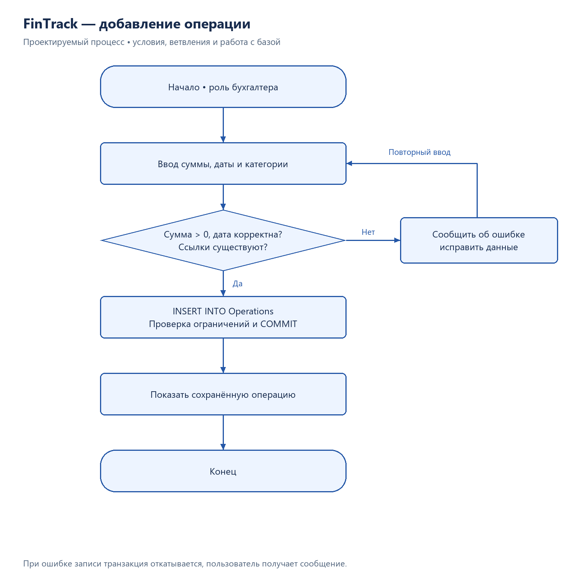
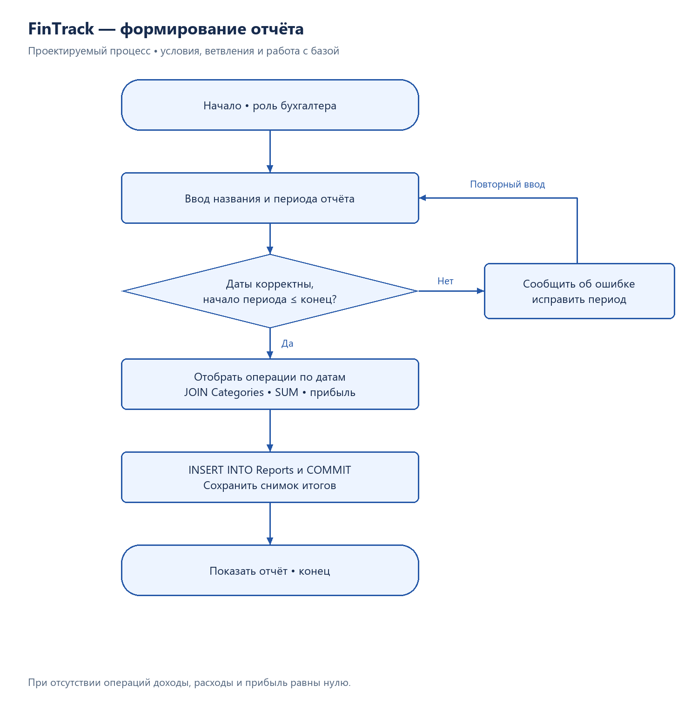

# Учет доходов/расходов небольшой фирмы
## Цель работы
Изучить основные этапы создания информационной системы. Научиться описывать её задачи, пользователей и основные функции. Получить навыки создания  Use Case диаграмм и блок-схем для наглядного представления работы системы.
## Практическая часть
## 1. Постановка задачи
### 1.1 Описание предметной области
Предметной областью проекта является финансовый учет небольшой фирмы. Для учёта доходов и расходов проектируется информационная система «FinTrack». В целевой системе бухгалтер ведёт операции и формирует отчёты, руководитель просматривает и ищет операции, контролирует финансовые показатели. В текущей учебной реализации подготовлены база SQLite, SQL создания и заполнения базы, диаграммы и консольная программа проверки. Пользовательские сценарии на диаграммах описывают дальнейшую реализацию системы.
### 1.2	Цели и задачи системы
1.	**Регистрация доходов фирмы**  
2.	**Регистрация расходов фирмы**  
3.	**Хранение информации о финансовых операциях**  
4.	**Поиск и просмотр операций**  
5.	**Изменение и удаление операций**  
6.	**Расчёт общей суммы доходов**  
7.	**Расчёт общей суммы расходов**  
8.	**Расчёт прибыли фирмы**  
9.	**Формирование финансовых отчётов**  

### 1.3 Пользователи системы (актеры) и их роли

- **Руководитель:** обычный пользователь. Просматривает и ищет финансовые операции, а также финансовые отчеты.
- **Бухгалтер:** главный пользователь. Добавляет, удаляет, изменяет информацию о финансовых операциях, формирует финансовую отчетность.

### 1.4 Основной функционал

-	**Добавление дохода** (ввод полученной суммы, даты и категории поступления)
-	**Добавление расхода** (ввод затраченной суммы, даты, а также категории расхода)
-	**Редактирование доходов/расходов** (изменение данных сохраненной финансовой операции)
-	**Удаление доходов/расходов** (удаление данных об операциях)
-	**Просмотр финансовых операций/отчетов**
-	**Расчет финансовых показателей**
-	**Формирование отчетов**

### 1.5 Архитектура проекта
Для проекта используется трехуровневая архитектура. Система состоит из трех основных уровней:
1.	**Слой интерфейса:** предназначен для взаимодействия пользователя с системой. С помощью него пользователь может просматривать и добавлять операции, просматривать финансовую отчетность и показатели.  
2.	**Слой бизнес-логики:** отвечает за обработку данных и правила работы системы.  
3.	**Слой данных:** отвечает за хранение информации. Хранит информацию о пользователях, финансовых операциях и т.д.  

Выбраны Python 3, стандартный модуль `sqlite3` и файловая СУБД SQLite. В текущей версии слой данных реализован таблицами и SQL, консольная программа проверяет базу. Следующие этапы реализации — бизнес-логика операций и отчётов, затем интерфейс и проверка прав пользователей.

| Роль | Планируемые действия |
|---|---|
| Бухгалтер | Добавление, редактирование, удаление, поиск и просмотр операций, формирование и просмотр отчётов и показателей |
| Руководитель | Поиск и просмотр операций, просмотр отчётов и показателей |
## 2. Моделирование процессов и взаимодействий 
### 2.1 Use-case диаграмма:


### Er-диаграмма "Финансовый учет небольшой фирмы"


[Исходник Use Case](docs/diagrams/diagram.puml) и [исходник ER-диаграммы](docs/diagrams/er-diagram.puml) доступны для редактирования в PlantUML.

### 2.2 Блок-схемы основных процессов

Добавление операции с проверкой суммы, даты и ссылок на пользователя и категорию.



[Исходник блок-схемы добавления](docs/diagrams/add-operation.puml)

Формирование отчёта с проверкой периода, подсчётом показателей и сохранением снимка итогов.



[Исходник блок-схемы отчёта](docs/diagrams/make-report.puml)

## 3. База данных и лабораторная работа 3

Готовая база находится в [src/fintrack.db](src/fintrack.db). [src/schema.sql](src/schema.sql) создаёт ту же структуру и заполняет все пять таблиц тестовыми данными. Скрипт выполняется в транзакции. Его повторный запуск удаляет прежние таблицы и заменяет данные учебным набором.

| Таблица | Назначение | Тестовых записей |
|---|---|---|
| Roles | Роли пользователей | 2 |
| Users | Пользователи, хеши паролей, активность и роль | 2 |
| Categories | Категории и тип операции `income` или `expense` | 6 |
| Operations | Финансовые операции, их суммы, даты и авторы | 12 |
| Reports | Автор, название, период, время формирования и снимок финансовых итогов | 3 |

В исходной базе сохранены все 12 операций, идентификаторы, пользователи и их хеши паролей. Поле `login` приведено к имени `username`, даты отчётов — к `period_start` и `period_end`. Добавлены описание ролей, активность пользователей, названия и время создания отчётов. Время `created_at` исходных отчётов отражает пересоздание учебной базы, поскольку прежняя версия это поле не хранила.

### 3.1 Ключи и связи

`PK` на диаграмме обозначает первичный ключ, `FK` — внешний. Тип `INTEGER` используется для идентификаторов и активности, `TEXT` — для текста и дат, `REAL` — для сумм. Звёздочка обозначает обязательное поле.

| Родительская таблица | Дочерняя таблица и внешний ключ | Кратность |
|---|---|---|
| Roles.role_id | Users.role_id | 1 к 0..N |
| Users.user_id | Operations.user_id | 1 к 0..N |
| Categories.category_id | Operations.category_id | 1 к 0..N |
| Users.user_id | Reports.user_id | 1 к 0..N |

Каждая дочерняя запись ссылается на одного существующего родителя. `ON DELETE RESTRICT` защищает используемые роли, пользователей и категории от удаления, `ON UPDATE CASCADE` обновляет внешние ключи при изменении идентификатора родителя. При открытии соединения для записи требуется `PRAGMA foreign_keys = ON`.

Ограничения проверяют уникальность логинов и названий ролей, положительную сумму операции, допустимый тип категории и активность 0 или 1. Даты проверяются на формат `YYYY-MM-DD` и календарную корректность. Для отчёта проверяются порядок дат, неотрицательные доходы и расходы и равенство прибыли их разности с допуском менее половины копейки.

### 3.2 Расчёт отчётов

Доход или расход определяется через `Categories.operation_type`. Суммы операций всегда положительны. Отчёт охватывает операции всей фирмы за указанный период включительно. `Reports.user_id` обозначает автора отчёта.

Скрипт использует `JOIN` для получения типа категории, `SUM` и `CASE` для суммирования, `COALESCE` для нулевого результата при отсутствии операций. Прибыль равна доходам за вычетом расходов. В `Reports` сохраняется снимок итогов. После последующего изменения операций для актуальных итогов нужно сформировать новый отчёт.

| Период | Доходы | Расходы | Прибыль |
|---|---|---|---|
| Сентябрь 2026 | 137000 | 55500 | 81500 |
| Октябрь 2026 | 115000 | 63000 | 52000 |
| Сентябрь и октябрь 2026 | 252000 | 118500 | 133500 |

### 3.3 Запуск и проверка

Нужен Python 3. Дополнительные пакеты для работы программы не требуются. Из корня проекта запустите следующую команду.

```console
python src/main.py
```

Из папки `src` работает команда `python main.py`. Путь к базе определяется относительно расположения программы. Проверка открывает файл только для чтения, выводит количество записей, поля и типы, результаты `integrity_check` и `foreign_key_check`. Ожидаются количества 2, 2, 6, 12, 3, целостность `[('ok',)]` и ошибки связей `[]`.

Для создания отсутствующей базы из SQL запустите следующую команду из корня проекта.

```console
python src/main.py --init
```

Если база уже существует, программа сообщает об этом и завершает работу. Для учебного пересоздания сначала переместите существующий `src/fintrack.db` в резервную копию, затем повторите команду с `--init`. При ошибке создания незавершённый новый файл удаляется.

Для просмотра таблиц можно открыть `src/fintrack.db` в DB Browser for SQLite или SQLiteStudio. Например, этот запрос показывает операции вместе с автором и категорией.

```sql
SELECT o.operation_id, u.username, c.category_name,
       c.operation_type, o.amount, o.operation_date
FROM Operations AS o
JOIN Users AS u ON u.user_id = o.user_id
JOIN Categories AS c ON c.category_id = o.category_id
ORDER BY o.operation_date, o.operation_id;
```
